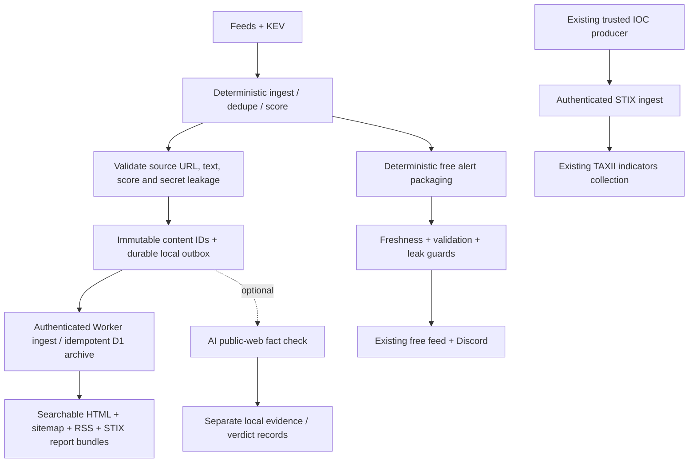

# SecurityCyber — Free operational CTI

A deterministic, source-attributed CTI pipeline for defenders. Ingest deduplicates
and scores feed items using rules and CISA KEV context. Eligible items become
searchable advisories with three takeaways, preserved technical source text,
provenance, RSS and STIX exports. No payment, account or AI service is required.

AI remains a **complementary fact-checking engine**. When the existing Codex CLI
is available and authenticated, it can consult public sources and record a
separate check with evidence links. It cannot rewrite source records, assert
human verification, or block publishing. Source excerpts are not novel research,
confirmed attribution, or automatic evidence that an IP/hash is malicious.

## Logic flow



The archive is delivered before optional AI runs. Delivery failures leave the
outbox intact for retry, including runs with no new candidates. A successful
receipt must acknowledge the exact document ID. Retries do not duplicate archive
records. Each run attempts at most 100 pending documents. This is distinct from
the older Discord delivery path, which retains its existing deduplication.

The default archive floor is a deterministic pre-score of **50**. Source text
must be present; malformed items and detected secret leakage are rejected.
Content changes produce a new advisory ID; unchanged source content reuses its
ID. Scores and source dates from the first accepted version are retained.
Three takeaways summarize the reported subject, a generic exposure-check action,
and the verification limitation. Full supplied source detail remains below them.

## Public interfaces

| Interface | Purpose |
|---|---|
| `/advisories` | Server-rendered archive; `?q=` searches exact text, CVEs or hashes |
| `/advisories/<id>` | Stable, indexable advisory with canonical URL |
| `/advisories/<id>.json` | Source record and provenance |
| `/advisories/<id>.stix.json` | STIX 2.1 report, course of action and source-mentioned CVEs |
| `/rss.xml` | Latest 50 source advisories, including technical detail |
| `/sitemap.xml` | Sitemap index for the complete archive |
| `/api/alerts` | Existing free alert API, retained |
| `/taxii2/` | Existing TAXII 2.1 discovery URL, retained |
| `/taxii2/api/` | Existing TAXII API root, retained |
| `/taxii2/api/collections/indicators/` | Existing read-only IOC collection, retained |
| `/taxii2/api/collections/indicators/objects/` | Indicator polling, pagination and filters |

The TAXII collection continues to carry **indicators from the existing producer**.
Advisory reports do not pollute that collection or convert incidental IPs, domains
or hashes into indicators. OpenCTI/TIP consumers may import the separate advisory
STIX bundles. Existing SIEM/TIP connections keep their discovery/root/collection
settings. Anonymous reads remain supported; `/internal/stix` still requires
`Bearer INGEST_SECRET`.

TAXII supports `limit`, `next`, `added_after`, `match[id]`, `match[type]`,
`match[spec_version]` and `match[version]`, plus manifest, individual objects and
available object versions. Storage retains only the latest accepted version per
indicator; this upgrade does not claim historical-version retention. An update
advances `added`, making it visible to incremental readers; replayed/older
versions do not. Pagination uses timestamp **and ID** so equal timestamps cannot
skip indicators. Storage failures return 503 rather than an empty success.
Clients should treat `next` as opaque and persist `added_after` only after draining
all pages. Old timestamp-only `next` tokens are rejected; restart that in-flight
poll from its prior `added_after` checkpoint after upgrading.

## Optional AI checks

`CTI_AI_FACTCHECK_ENABLED=1` (default) permits a bounded Codex public-web check when
the CLI is installed and authenticated. Set it to `0` to disable AI completely.
At most three unchecked documents are submitted per run, with a 120-second call
limit. Results are stored separately in:

```
state/advisory-outbox/documents/<id>.json
state/advisory-outbox/receipts/<id>.json
state/advisory-outbox/factchecks/<id>.json
```

Checks carry a supported/contradicted/uncertain verdict, explanation and evidence
URLs. They remain operator-review annotations, not public verified labels. A
successful web tool response and syntactically valid URLs are not proof that the
model checked every claim. Other legacy analyst adapters remain available for
manual use; they are not required by the scheduled deterministic path.

## Safe upgrade

1. Back up code and D1. Preserve live `config/env`, `config/settings.yaml`, queues,
   credentials and existing indicator records. Hold `state/.lock` during host edits.
2. Apply the additive Worker migration **before** deploying Worker code:

   ```sh
   cd worker
   npx wrangler d1 execute cti-subs --remote --file migrations/0003_advisories.sql
   npm run deploy
   ```

3. Install the updated host code. Keep `CTI_WORKER_URL` and `CTI_INGEST_SECRET`.
   The latter must match the Worker's `INGEST_SECRET`. No new secret is needed.
4. Check `/healthz`, `/advisories`, `/rss.xml`, `/taxii2/`, collection metadata and
   object pagination. Existing timer runs invoke the new stages automatically.

These commands are deployment instructions, not actions performed by the test
suite. Do not run `bin/run.sh`, publishers or the live ingest endpoints as a smoke
test: they may send real messages. Inspect a local fixture instead:

```sh
python3 bin/advisory_pipeline.py --candidates /tmp/candidates.json \
  --output-dir /tmp/cti-preview
```

`--flush` explicitly sends pending records to the configured Worker. Without it,
the command only creates local artifacts. Direct CLI invocations that write the
production outbox must also hold `state/.lock`; `run.sh` already does so.

Billing/account endpoints and subscriber jobs are retired. Legacy modules and
historical data are retained for rollback; this code does not cancel anything in
an external payment provider. The old standalone paid site redirects to the free
feed. Social subscriber lead time is removed. Deterministic packaging does not
automatically turn source summaries into independent analyst social posts; manual
publishing and existing guarded queue handling remain available.

## Validation

```sh
python3 tests/test_advisory_pipeline.py
python3 tests/test_codex_analyst.py
python3 tests/test_grounding.py
python3 tests/test_social_pacing.py
cd worker && npm test
```

Tests use temporary files, SQLite and in-process HTTP Request/Response objects.
They cover durable retry and duplicate acknowledgements, provenance hashes,
secret rejection, AI output boundaries, HTML escaping, RSS, search, STIX export,
existing TAXII routes and equal-timestamp pagination. No messages are sent.
See [the upgrade audit](docs/UPGRADE-AUDIT.md) for results and remaining limits.

## Distribution and operational proof

The archive, RSS and TAXII interfaces are the primary distribution surfaces.
Social posts are supplementary. Existing shared Discord delivery remains.
Aggregator operators can subscribe/poll or import the structured exports; no
unsolicited AbuseIPDB reports, GitHub advisories or community messages are sent.
Document original telemetry and evidence before publishing maliciousness claims.
No special programme membership or third-party endorsement is implied.

Protocol references: [STIX 2.1](https://docs.oasis-open.org/cti/stix/v2.1/os/stix-v2.1-os.html)
and [TAXII 2.1](https://docs.oasis-open.org/cti/taxii/v2.1/os/taxii-v2.1-os.html).
Legacy installation details remain in [docs/SETUP.md](docs/SETUP.md); this README
supersedes its AI-required, paid-service and subscriber-first descriptions.
